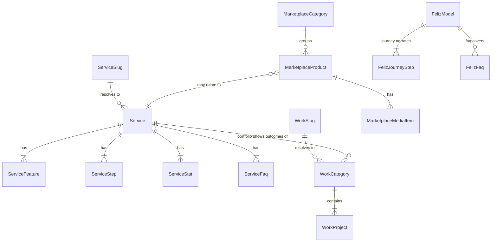

# ERD — Data Model (Single Source of Truth)

> Upstream: [Constitution Law 4](constitution.md) · [Module Map §3](architecture/modules.md).
> **Rule:** any change to a data shape below must update this file **in the same
> task, before delivery.**

---

## 0. Current State (Honest Baseline)

PENCIL Studio today has **no database, no ORM, and no server-side persistence**.
The "data layer" is a set of typed, code-resident content modules in `lib/**`,
consumed by statically generated pages. The diagram below documents these content
entities and their relations, verified against the actual exports on
2026-11-21.

When a real database is introduced, this file becomes its schema documentation
(models, fields, PK/FK, constraints) and the Mermaid diagram is extended in the
same task.

## 1. Entity-Relation Diagram (Mermaid)

## 2. Entity Reference (verified interfaces)

### 2.1 Services — `lib/services/services.ts`

| Entity | Role | Notes |
| --- | --- | --- |
| `ServiceSlug` | Union type of route slugs | Drives `app/services/[slug]` static params |
| `Service` | Root content entity | Bilingual copy, pricing info |
| `ServiceFeature` / `ServiceStep` / `ServiceStat` / `ServiceFaq` | Owned children | Composed inside a `Service` |
| `serviceSlugById` | id → slug map | Lookup helper (`Record<string, ServiceSlug>`) |
| `services: Service[]` | Dataset root | `generateStaticParams` source |

### 2.2 Portfolio / Works — `lib/portfolio/portfolio-content.ts`

| Entity | Role | Notes |
| --- | --- | --- |
| `WorkSlug` | Union type of category slugs | `app/work/[slug]` |
| `WorkCategory` | Category root | Bilingual title/copy |
| `WorkProject` | Project inside a category | Feeds `app/work/[slug]/[project]` |
| `WORK_CATEGORIES: WorkCategory[]` | Dataset root | |
| `getWork(slug): WorkCategory \| undefined` | Public lookup | Consumers must handle `undefined` (strict-access rule) |

### 2.3 Marketplace — `lib/marketplace/marketplace-data.ts`

| Entity | Role |
| --- | --- |
| `MarketplaceCategory` | Grouping tier (`MARKETPLACE_CATEGORIES`) |
| `MarketplaceProduct` | Product root (`MARKETPLACE_PRODUCTS`), bilingual |
| `MarketplaceMediaItem` | Owned media entries per product |

### 2.4 Feliz / SuperFeliz — `lib/feliz/feliz.ts` (+ `feliz-demo.ts`)

| Entity | Role |
| --- | --- |
| `FelizTier` | `"Free" \| "PRO"` |
| `FelizModel` | AI-agent model root (`felizModels`) |
| `FelizJourneyStep` | Journey narrative steps (`felizJourney`) |
| `FelizFaq` | FAQ entries (`felizFaqs`) |

### 2.5 Supporting content modules

| Module | Serves |
| --- | --- |
| `lib/method/method-content.ts` | `/build-launch`, `/design-experience`, `/strategy-direction` (method pages) |
| `lib/pricing/pricing-currency.ts` | Currency conversion (USD base, live bank rates with offline fallback) |
| `lib/studio-care/studio-care-content.ts` | Studio-care UI |
| `lib/support/**` (`pencil-support-operations`, callback/customer/report/technical) | Support routes |
| `lib/help/**` (contact intents, FAQs, guides/playbooks) | Help-center routes |

## 3. Modification Protocol

1. Shape change to any entity above → update this ERD in the same task
   (Constitution Law 4.4).
2. New content module → add its entities here and to
   [Module Map §3](architecture/modules.md).
3. Breaking shape change → follow deprecate → migrate → remove
   (Constitution Law 4.3).
4. Future database: table per entity, slugs as natural keys with uniqueness
   constraints, and this document gains a constraints section.
